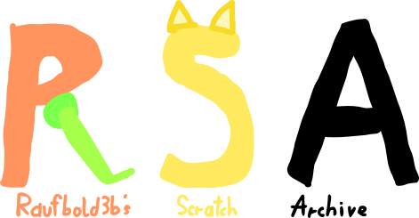

---
**An Austrian indie studio building all sorts of stuff, all inside of one universe – the TrafkVerse.**

## About the Studio:
**TrafkHop Entertainment™** is an independent, one-person game studio from Austria, founded by **Daniel "HoppiTex" Raberger** on the **16th of December 2025**.

We specialize in gameplay-driven RPGs inspired by classics (like Mario & Luigi, Chrono Trigger) and push them forward – while also building other things: a Linux distribution, other games, a randomized wallpaper application and more.

> *"Beyond the familiar, with a single hopp, unveils itself a world wholly unknown."*
> 
> *"Mittels eines Hüpfers, jenseits des Vertrauten, offenbart sich fortan eine Welt, vollkommen und unbekannt."*

**Motto:** *Creativity conquers all!* · *Der Kreative wird siegen!*

Every TrafkHop project lives inside the **TrafkVerse** – a single, meticulously crafted multiverse with a logic-based magic system, its own history, cultures and geographies. Consistency is non-negotiable: *a game can only exist if its story exists up to that point.*

## What We Aim For:

| Type           | Answer                                               |
| -------------- | ---------------------------------------------------- |
| **Genres**     | RPGs first, but long-term: every genre               |
| **Aesthetic**  | Early-2000s cartoon/anime, Gamecube/Dreamcast-era 3D |
| **Music**      | Japanese / classical / indie inspired                |
| **Flavor**     | Austrian culture & folklore                          |
| **Foundation** | One universe, one magic system, one canon            |

## Projects:
> Full list: [TrafkSite/Projects](https://trafkhop-entertainment.github.io/TrafkSite/Projects/Projects.html)

| Project                                                                                                                                           | What it is                                                                                     | Stack                |
| ------------------------------------------------------------------------------------------------------------------------------------------------- | ---------------------------------------------------------------------------------------------- | -------------------- |
| [**TrafkTux**](https://trafkhop-entertainment.github.io/TrafkSite/Websites/TrafkTux.html)                                   | An Arch Linux-based distribution with an artistic vision.                                      | Arch / Bash / C      |
| [**TrafkSite**](https://trafkhop-entertainment.github.io/TrafkSite/)                                                        | The official TrafkHop website – wiki, lore, project info.                                      | HTML / CSS           |
| [**SourceHop**](https://trafkhop-entertainment.github.io/TrafkSite/Projects/Websites/SourceHop.html)                        | Asset collection (notes, images, audio, models, code, GDScenes) – some usable in fan projects. | Mixed                |
| [**TrafkVerse Wallpaper**](https://trafkhop-entertainment.github.io/TrafkSite/Projects/Websites/TrafkVerseWallpaper.html)  | Procedural wallpaper that generates symbols & shapes which play sounds.                        | SF2 / C              |
| [**Raufbold3bs Scratch Archive**](https://trafkhop-entertainment.github.io/TrafkSite/Projects/Websites/RSA.html)           | Collection of 15 early Scratch games.                                                          | Scratch / Penguinmod |
| [**TrafkCalc**](https://trafkhop-entertainment.github.io/TrafkSite/Projects/Websites/TrafkCalc.html)                                              | A simple calculator for the TrafkVerse lore.                                                   | C                    |

## Part of TetraBox

TrafkHop is one of **four studios** forming **TetraBox** – a small collaboration. TrafkHop contributed the name and the color identity.

## Fan Works & Contributions:

Fan works are **welcome** – under the terms of our license:

- $\checkmark$ Non-commercial **fan art, fan games, animations, mods** – with credit and clearly marked as unofficial
- $\checkmark$ **Gameplay videos & streams** with your own commentary (platform monetization allowed)
- $X$ No forking / mirroring / re-uploading of our repos and projects
- $X$ No AI training on our content
- $X$ No commercial use without explicit written permission

-> The full, authoritative rules – including third-party licenses (Backrooms, GPL, MIT, etc.) and the **only valid form of written permission** (signed PDF via GPG key) – are in **[`LICENSE.txt`](https://github.com/TrafkHop-Entertainment/SourceHop-Documents/blob/main/Licenses/LICENSEv5)**.

**Pull requests:** by submitting a contribution, you grant TrafkHop Entertainment™ exclusive exploitation rights to it (moral rights remain yours). See **§1b** of the license. If that's not what you want, open an issue first instead.

## Contact

| Form      | Contact                                                         |
| --------- | --------------------------------------------------------------- |
| **Email** | [contact.trafkhop@proton.me](mailto:contact.trafkhop@proton.me) |

---
**Thinking since 2025.**

© 2026 TrafkHop Entertainment™ – All rights reserved. (See more via our Website)